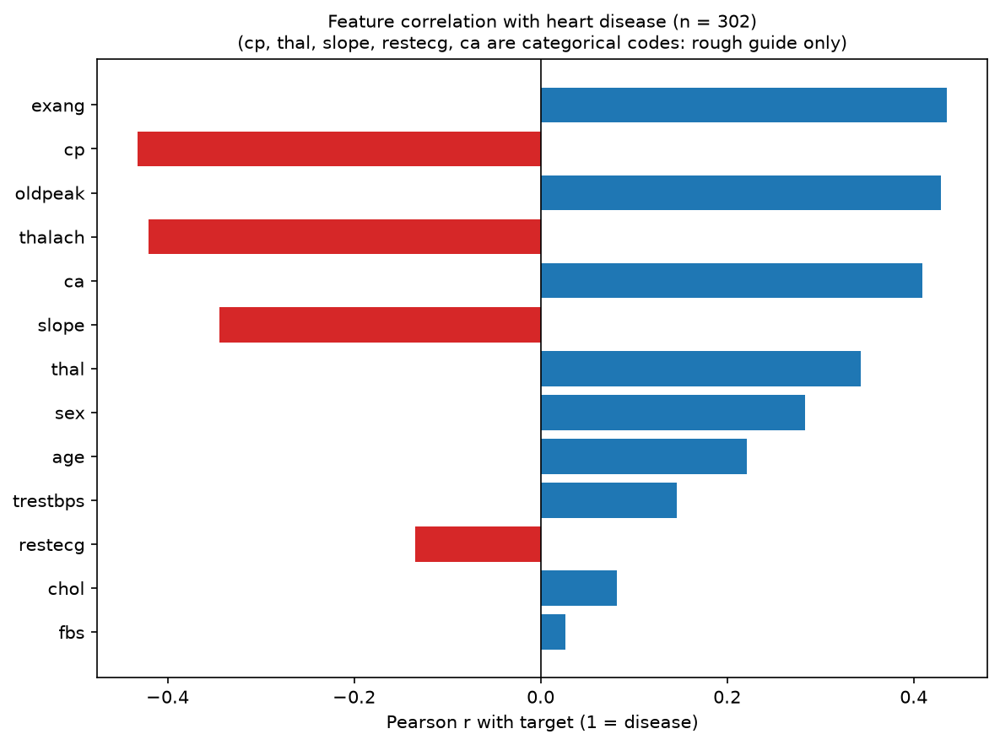
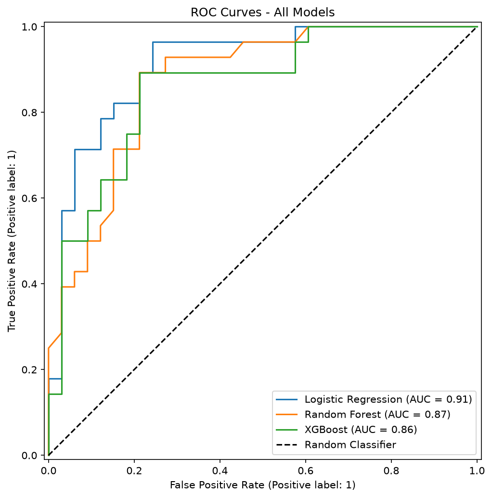
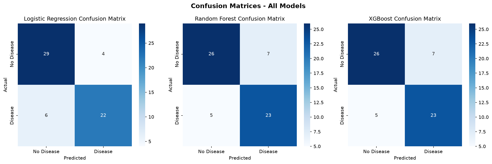
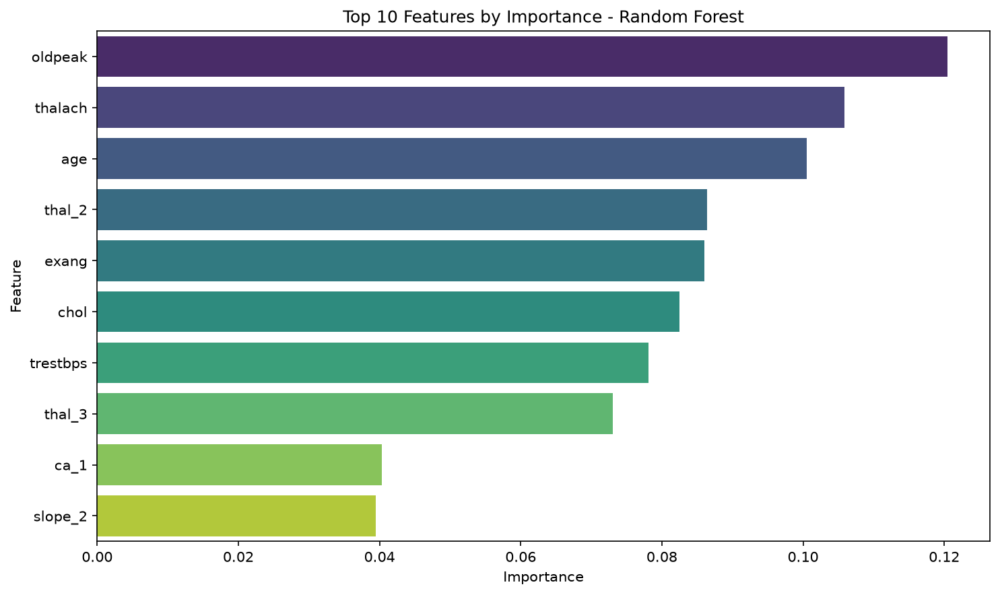

# Heart Disease Prediction: a comparative ML study on 302 patients


-teal?style=flat-square)

> **Headline:** 723 of the 1,025 rows in the popular Kaggle copy of this dataset were exact duplicates (70%). Removing them and validating properly, logistic regression reached **0.91 ROC AUC and 83.6% accuracy (51 of 61) on held-out patients**, with a 95% interval of about 74–92% that shows how little 61 patients can prove. I also found that the copy's labels are reversed, and verified that against the raw UCI file.

---

## Problem statement

Heart disease is a leading cause of death worldwide, and a missed diagnosis is far costlier than a false alarm. Suppose a clinic wants a quick triage score from routine measurements (age, blood pressure, cholesterol, resting ECG, an exercise stress test) to decide who should be referred for further testing first.

This project asks three questions:

1. **How well can 13 routine clinical measurements flag patients who have heart disease?**
2. **Do more complex models (Random Forest, XGBoost) beat a simple logistic regression on a dataset this small?**
3. **How much should we trust a result built on a few hundred patients?**

The most valuable lesson was not a model: it was catching two data problems (duplicate rows and reversed labels) that would have produced misleading results.

## Data

| Property | Detail |
|---|---|
| Original source | UCI Machine Learning Repository, *Heart Disease* (Cleveland Clinic subset). Janosi, Steinbrunn, Pfisterer & Detrano (1989). [doi:10.24432/C52P4X](https://doi.org/10.24432/C52P4X) |
| License | CC BY 4.0 (stated on the [UCI dataset page](https://archive.ics.uci.edu/dataset/45/heart+disease)) |
| File used | `data/heart.csv`, a Kaggle-style copy: 1,025 rows x 14 columns |
| Unique patients | **302** (723 exact duplicate rows removed). All 302 match a patient in the UCI Cleveland file |
| Features | 13: `age`, `sex`, `cp` (chest pain type), `trestbps` (resting BP), `chol`, `fbs`, `restecg`, `thalach` (max heart rate), `exang` (exercise-induced angina), `oldpeak` (ST depression), `slope`, `ca` (major vessels), `thal` |
| Target | Heart disease present (1) or absent (0), after the label correction below |
| Class balance | 138 disease / 164 no disease (46% / 54%); no resampling used |
| Missing values | None in the file; UCI's missing `ca` and `thal` values appear as out-of-range codes (see below) |

**Known issues in this copy of the data**

- **Duplicates.** The file repeats the 302 patients about 3.4 times each on average. Left in, identical rows land in both the training and test sets and inflate scores to near 100%.
- **Reversed labels.** In this copy `target = 1` means *no* disease. Evidence: for all **302 of 302** de-duplicated rows matched to the raw UCI Cleveland file, `target == 1` coincides with the UCI diagnosis "no disease" ([`scripts/verify_label_coding.py`](scripts/verify_label_coding.py) reproduces this); UCI has 164 patients with no disease and this copy has 164 rows with `target = 1`; and known risk markers (`exang`, `oldpeak`, `ca`) correlate negatively with the original label. The notebook flips the label so **1 = disease** everywhere. The CSV itself is not modified.
- **Out-of-range codes.** 4 rows have `ca = 4` and 2 rows have `thal = 0`; the documented ranges are 0–3 and 1–3. They correspond to the 4 missing `ca` and 2 missing `thal` values in the UCI Cleveland file. They were kept (the true values are unknown) and are reported rather than silently fixed.

## Methodology

1. **Clean:** drop exact duplicates, check for missing values and out-of-range codes, correct the label coding.
2. **Explore:** class balance, correlations with the target, distributions by class.
3. **Encode:** one-hot encode the categorical columns `cp`, `restecg`, `slope`, `ca`, `thal`.
4. **Split:** 80/20 stratified train/test split (241 / 61 patients, `random_state=42`). The test set is only used for the final comparison.
5. **Avoid leakage:** scaling lives inside a scikit-learn `Pipeline`, so the scaler is fit only on the training portion of each cross-validation fold.
6. **Compare four models:** a majority-class baseline, Logistic Regression, Random Forest, XGBoost (all with fixed seeds).
7. **Validate:** 5-fold stratified cross-validation on the training set (ROC AUC), then a single held-out test evaluation.
8. **Quantify uncertainty:** 2,000-resample bootstrap on the 61 test patients for 95% intervals, and a paired bootstrap for the gaps between models.
9. **Read the errors:** confusion matrices, sensitivity/specificity, and a decision-threshold table.

Why these choices: logistic regression is the interpretable linear baseline; Random Forest and XGBoost test whether non-linear structure helps; the majority-class baseline shows what "no skill" scores; and with only 61 test patients, intervals matter more than a single accuracy figure.

## Results

All numbers are printed by the executed cells of [`notebooks/heart_disease_analysis.ipynb`](notebooks/heart_disease_analysis.ipynb).

**5-fold cross-validation (training set, ROC AUC)**

| Model | Mean AUC | Std |
|---|---|---|
| Majority-class baseline | 0.500 | 0.000 |
| **Logistic Regression** | **0.910** | 0.036 |
| Random Forest | 0.890 | 0.035 |
| XGBoost | 0.878 | 0.025 |

**Held-out test set (61 patients: 33 healthy, 28 with disease)**

| Model | Accuracy (95% CI) | Recall (sensitivity) | Precision | F1 | AUC (95% CI) |
|---|---|---|---|---|---|
| Majority-class baseline | 0.541 (0.43–0.67) | 0.000 | 0.000 | 0.000 | 0.500 |
| **Logistic Regression** | **0.836** (0.74–0.92) | 0.786 | 0.846 | 0.815 | **0.912** (0.83–0.97) |
| Random Forest | 0.803 (0.71–0.90) | 0.821 | 0.767 | 0.793 | 0.872 (0.78–0.95) |
| XGBoost | 0.803 (0.71–0.90) | 0.821 | 0.767 | 0.793 | 0.862 (0.76–0.95) |

**Is logistic regression really better?** Its accuracy lead is +3.2 points over each tree model, which is about 2 patients out of 61. The 95% bootstrap interval for that gap is [-4.9, +13.1] points against Random Forest and [-4.9, +11.5] against XGBoost, so it includes zero. The honest reading: **logistic regression has the best point estimates, but on this data the three models cannot be statistically separated.** All three clearly beat the baseline.

### Visuals



*`exang`, `oldpeak`, `ca` and `thalach` show the strongest linear association with disease; the bars for the categorical codes (`cp`, `thal`, `slope`, `restecg`, `ca`) are only a rough guide.*







## Key insights

- **The data-quality catch mattered more than the model choice.** With duplicates left in, the same patient appears in both train and test, which produces near-perfect scores. Honest performance is about 0.91 AUC.
- **Which errors the model makes.** At the default 0.5 threshold, logistic regression correctly identifies 22 of 28 patients with disease (6 missed) and 29 of 33 healthy patients (4 false alarms). For screening, missed patients are the costly error.
- **Threshold changes the trade-off.** Lowering the decision threshold to 0.3 cuts missed patients from 6 to 2, at the cost of raising false alarms from 4 to 8 (sensitivity 0.93, specificity 0.76). Where to set it is a clinical-cost decision, not a modelling one.
- **What drives predictions.** Random Forest's two most important features are `oldpeak` and `thalach`, both exercise-test measurements. Logistic regression's largest coefficients belong to the number of major vessels (`ca`), chest-pain type (`cp`) and `sex`. These are consistent with the correlation chart, but importance here is not causal.
- **Simple was enough.** A linear model matched or beat two ensemble methods on 302 patients, but see the interval above: the evidence for "better" is weak.

## Limitations and future improvements

- **Small sample.** 302 patients from one clinic, a single 61-patient test split. A different split changes the answer: recoding the labels re-draws the stratified split (only 14 of the 61 test patients are shared with the earlier split), and logistic regression's test accuracy moved from 85.2% to 83.6% as a result. Repeated or nested cross-validation would give steadier estimates.
- **No external validation.** Results may not carry over to other hospitals, populations or equipment.
- **Not a diagnostic tool.** This is a learning project; no medical conclusions should be drawn from it.
- **Categorical codes.** Pearson correlation on nominal codes is only a rough guide; Random Forest impurity importances favour continuous features.
- **Defaults.** Models use near-default hyperparameters; no tuning was done (and with this little data, tuning needs nested CV to avoid overfitting).
- **Next steps:** nested cross-validation; probability calibration; SHAP values for per-patient explanations; choosing the decision threshold from an explicit cost of a missed case versus a false alarm; and testing on the other UCI hospital files (Hungarian, Switzerland, VA Long Beach) as a form of external validation.

## Installation and how to run

Tested with **Python 3.15** on Windows 11 using the pinned versions in `requirements.txt`. Install takes about 2 minutes and the full notebook runs in about 47 seconds (verified from a fresh clone).

```bash
git clone https://github.com/abdullahwaheed0112/heart-disease-prediction.git
cd heart-disease-prediction
python -m venv .venv
# Windows: .venv\Scripts\activate      macOS/Linux: source .venv/bin/activate
pip install -r requirements.txt
pip install jupyterlab
cd notebooks
jupyter lab heart_disease_analysis.ipynb
```

Run all cells from inside the `notebooks/` folder (paths are relative: the data is read from `../data/heart.csv` and figures are written to `../docs/images/`). You can also open the notebook in VS Code with the Python and Jupyter extensions. The saved outputs are already in the notebook, so it reads on GitHub without running anything.

**Optional: verify the label-coding finding.** Download the UCI archive from the [dataset page](https://archive.ics.uci.edu/dataset/45/heart+disease), unzip `processed.cleveland.data`, then run (needs only numpy):

```bash
python scripts/verify_label_coding.py path/to/processed.cleveland.data
```

## Project structure

```text
heart-disease-prediction/
├── data/
│   └── heart.csv                       # Kaggle-style copy of UCI Cleveland (1,025 rows incl. duplicates)
├── docs/
│   └── images/                         # figures generated by the notebook (used in this README)
├── notebooks/
│   └── heart_disease_analysis.ipynb    # full analysis with saved outputs
├── scripts/
│   └── verify_label_coding.py          # checks target coding against raw UCI data
├── requirements.txt
└── README.md
```

## Tech stack

Python · pandas · NumPy · scikit-learn (Pipelines, cross-validation) · XGBoost · matplotlib · seaborn · Jupyter

## My role, license and contact

- **Author:** Abdullah Waheed. BS Data Science student at FAST NUCES, Islamabad.
- **Data:** UCI Heart Disease dataset, CC BY 4.0; please cite Janosi et al. (1989), [doi:10.24432/C52P4X](https://doi.org/10.24432/C52P4X).
- **License for the code:** none chosen yet.
- **Contact:** [GitHub](https://github.com/abdullahwaheed0112) · [LinkedIn](https://linkedin.com/in/abdullah-waheed-05a5a1416)
